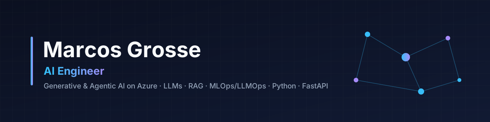

<!-- Banner -->

<h1 align="center">
Olá 👋 Eu sou Marcos Grosse
</h1>

<h3 align="center">
Building AI Solutions • Machine Learning • Cloud & Infrastructure
</h3>

Transformando problemas complexos em soluções inteligentes utilizando Inteligência Artificial, Machine Learning, Cloud Computing e Automação.

---

# 👨🏻‍💻 Sobre mim

Sou Engenheiro de Computação e atualmente atuo como **Analista de Tecnologia da Informação na Ferroport**, com experiência em infraestrutura corporativa, cloud, virtualização, redes e segurança.

Atualmente estou me especializando em **Machine Learning Engineering**, direcionando minha carreira para o desenvolvimento de soluções baseadas em Inteligência Artificial.

Tenho grande interesse em construir aplicações inteligentes utilizando Large Language Models (LLMs), AI Agents, Machine Learning, Cloud e Automação Inteligente.

---

# 💡 Atualmente construindo

🤖 AI Agents

🧠 Aplicações com LLMs

☁️ Soluções utilizando Azure AI

⚡ Automações Inteligentes com Python e n8n

📈 Projetos de Machine Learning

🔍 Aplicações com RAG

🚀 APIs para IA

---

# 🚀 Atualmente estudando

- Machine Learning Engineering (FIAP)
- Azure AI
- Azure AI Foundry
- Large Language Models (LLMs)
- AI Agents
- Retrieval-Augmented Generation (RAG)
- LangChain
- LangGraph
- Semantic Kernel
- MCP (Model Context Protocol)
- Prompt Engineering
- MLOps

---

# 🛠 Tech Stack

## 🤖 AI & Machine Learning

**Frameworks e Ferramentas**

- Azure OpenAI
- OpenAI API
- LangChain
- LangGraph
- Scikit-Learn
- Pandas
- NumPy

---

## 💻 Desenvolvimento

---

## ☁️ Cloud & DevOps

---

## 🖥 Infrastructure

- Windows Server
- Linux
- Active Directory
- VMware
- Hyper-V
- Redes
- Segurança
- Microsoft 365
- Azure
- Zabbix
- Grafana

---

# 📌 Áreas de Interesse

- Machine Learning Engineering

- AI Engineering

- Large Language Models

- AI Agents

- Intelligent Automation

- MLOps

- Cloud AI

- Prompt Engineering

- Retrieval-Augmented Generation

- AI Architecture

---

# 🏆 Roadmap de Certificações

| Status | Certificação |
|---------|--------------|
| 🟢 | AZ-900 |
| 🟢 | AI-900 |
| 🟢 | AI-102 |
| 🟢 | AI-3016 |
| 🟢 | AI-3025 |
| 🟢 | DP-100 |
| ⚪ | Azure AI Engineer Associate |

---

# 🚀 Projetos em Destaque

Em breve este espaço será preenchido com projetos voltados para Inteligência Artificial e Machine Learning.

### Projetos planejados

🤖 AI Agents

🧠 Chatbots com LLM

📄 RAG Applications

📈 Machine Learning

👁 Computer Vision

⚙ APIs Inteligentes

☁ Azure AI

📊 Dashboards Inteligentes

---

# 📊 GitHub Analytics

---

# 🔥 GitHub Streak

---

# 📈 Contribution Graph

---

# 🏅 GitHub Trophies

---

# 🤝 Vamos conectar?

---

# 💭 Filosofia

> **"Building intelligent systems that solve real-world problems."**

---

🚀 Learn • 🤖 Build • 📈 Improve

